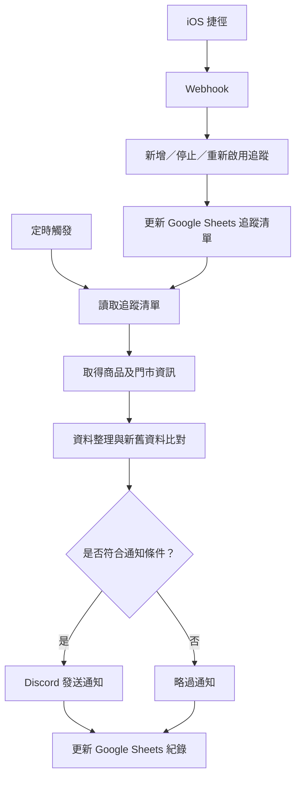
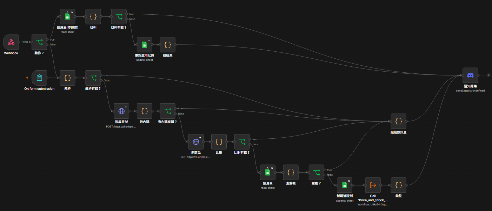
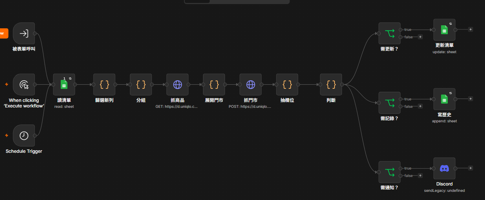
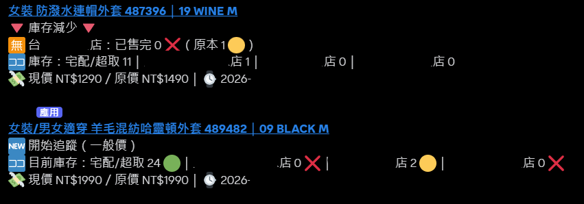
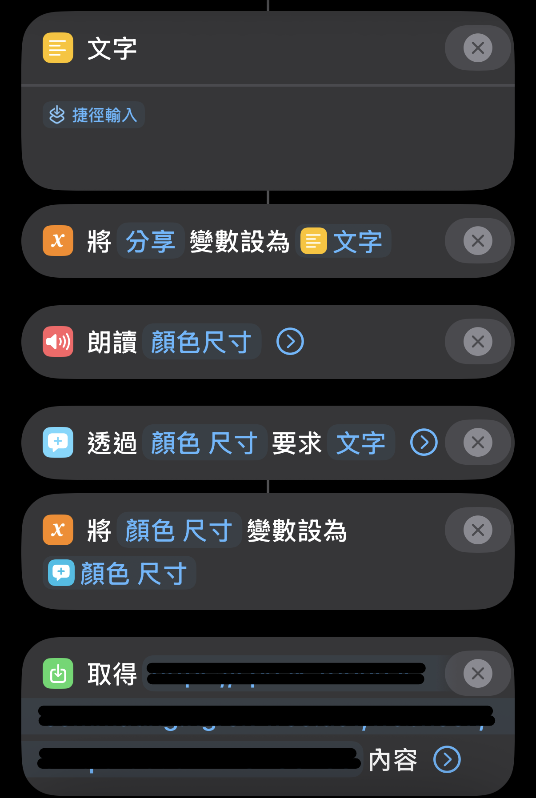

# UNIQLO 商品價格與庫存追蹤自動化系統

使用 n8n 建立商品價格與庫存追蹤系統，定期取得指定商品及門市的最新資訊，透過資料比對與條件判斷，自動偵測異動並發送通知，同時保存歷史紀錄。

本專案著重於自動化流程設計、資料處理、系統整合，以及使用者操作體驗。

## 專案目的

將原本需要人工定期查詢商品價格與庫存的工作，轉換為可持續執行的自動化流程。

系統依照追蹤清單執行，當商品價格或庫存符合預設通知條件時，自動發送 Discord 通知，減少人工反覆查詢的需求。

## 系統架構

## 核心功能

### 1. 商品價格與庫存追蹤
- 使用 n8n 建立定時執行流程。
- 依照追蹤清單，取得指定商品及門市的價格與庫存資訊。
- 比對最新資料與歷史紀錄，判斷價格或庫存異動。
- 依照設定條件發送通知，並保存每次執行結果。

### 2. 追蹤清單新增與維護
- 提供表單及手機端操作入口，新增商品追蹤項目。
- 透過 HTTP Request 取得 UNIQLO 網站商品資料，解析商品內碼、顏色、尺寸等資訊。
- 設計貨號、顏色及尺寸比對邏輯，處理同色號對應多個商品款式的情況。
- 檢查追蹤清單，避免重複新增相同商品組合。
- 支援依貨號及顏色尺寸停止或重新啟用追蹤。

### 3. 資料驗證與錯誤回饋
- 驗證輸入的貨號、顏色及尺寸格式。
- 當分享內容包含多個可能的貨號時，要求使用者明確指定，避免錯誤判斷。
- 當商品或顏色尺寸無法正確比對時，整理錯誤原因與候選項目。
- 透過 Discord 回傳操作結果及錯誤資訊，方便使用者修正後重新提交。

### 4. Discord 自動通知
- 當商品異動符合設定條件時，自動發送通知。
- 集中呈現新增追蹤、停止追蹤、重新啟用及追蹤異動資訊。
- 將操作結果與需要留意的商品資訊集中在指定頻道。

### 5. 手機端操作體驗
- 使用 iOS 捷徑提供手機端操作入口。
- 透過 Webhook 串接 n8n。
- 可從手機新增、停止或重新啟用追蹤項目。
- 降低直接操作 n8n 工作流程或編輯試算表的需求。

## 工作流程拆分

本系統將不同任務拆分為獨立工作流程：

| 工作流程 | 主要職責 |
|---|---|
| 追蹤清單操作流程 | 解析輸入、商品比對、重複檢查、新增／停止／重新啟用追蹤 |
| 價格與庫存通知流程 | 定時取得商品資訊、比對異動、條件判斷、發送通知及更新紀錄 |

追蹤清單操作流程在新增項目後，會呼叫價格與庫存通知子工作流程，讓新加入的追蹤項目進入後續處理流程。

## 使用技術

| 技術 | 用途 |
|---|---|
| n8n | 自動化流程設計、執行與工作流程整合 |
| HTTP Request | 取得 UNIQLO 網站商品資料 |
| Google Sheets | 保存追蹤清單及歷史紀錄 |
| Discord | 異動通知與操作結果回饋 |
| Webhook | 接收手機端操作請求 |
| iOS 捷徑 | 提供手機端操作介面 |

## 實作與改善重點

- **流程設計：** 將排程追蹤、資料處理、條件判斷、通知與清單維護拆分為不同工作流程。
- **資料處理：** 設計商品資訊解析、顏色尺寸正規化、新舊資料比對與重複檢查。
- **例外處理：** 針對輸入錯誤、商品比對失敗及重複資料設計不同回饋方式。
- **系統整合：** 串接 n8n、Google Sheets、Discord、Webhook 與 iOS 捷徑。
- **使用者體驗：** 考慮手機端操作情境，降低新增與調整追蹤項目的操作成本。
- **持續改善：** 依照實際測試與使用情況，調整資料解析、判斷邏輯及錯誤處理方式。

## 專案展示

### 系統操作畫面

#### 追蹤清單管理流程

#### 價格與庫存監測流程

#### Discord 自動通知

#### iOS 捷徑操作

### n8n 工作流程範例

以下提供兩份去除敏感資訊的 n8n 工作流程 JSON，展示系統的主要流程設計：

- [追蹤清單管理流程](examples/B-tracking-management-workflow.json)
  - 負責新增、停止及重新啟用商品追蹤。
- [價格與庫存監測流程](examples/A-price-stock-monitoring-workflow.json)
  - 負責定期取得商品資訊、比對異動及發送通知。

## 專案範圍與說明

本專案為個人實作專案，使用 n8n 建立自動化工作流程。商品資訊透過 HTTP Request 取得 UNIQLO 網站提供的資料；Google Sheets 用於保存追蹤清單與歷史紀錄。

展示內容以系統設計、流程整合、資料處理與使用者操作方式為主。工作流程範例已移除帳號憑證、私人連結及其他敏感設定，不包含可直接存取個人服務的資訊。
